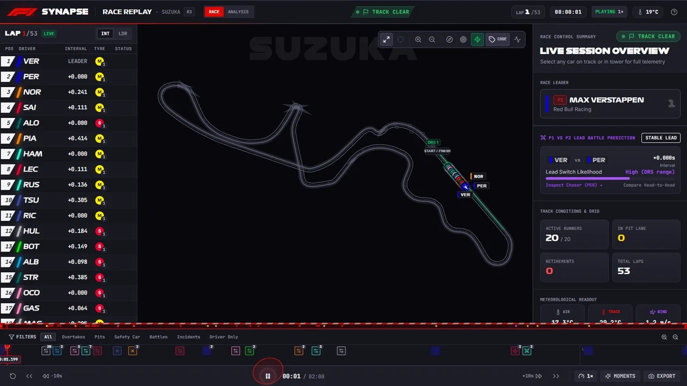
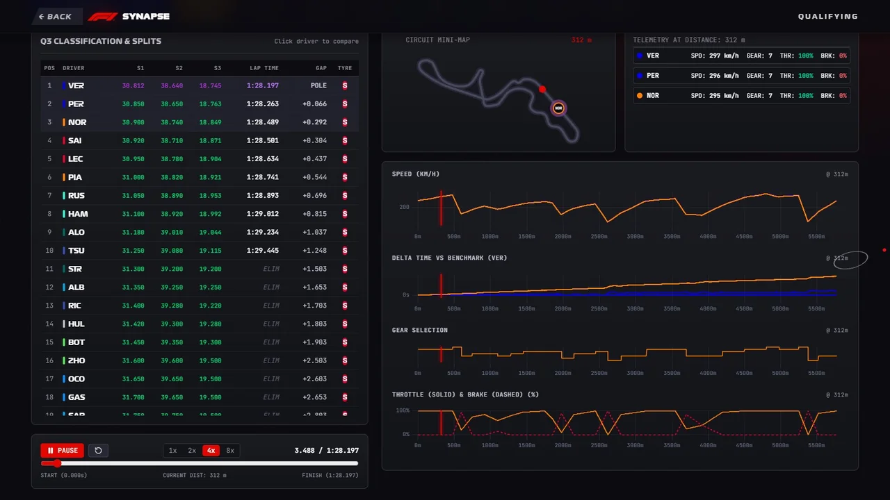

<!-- The banner and pipeline SVGs come from docs/readme/build_art.py. Re-run it after editing. -->



F1 Synapse replays real Formula 1 races lap by lap in the browser. Position, car data and timing all arrive at different rates, so the backend puts every channel on one 25 Hz clock first. That way the track map, timing tower, telemetry charts and predictions always describe the same instant.

<p>
  <a href="#quick-start"><b>Quick start</b></a> &nbsp;/&nbsp;
  <a href="#how-it-works">How it works</a> &nbsp;/&nbsp;
  <a href="#keyboard-controls">Keyboard</a> &nbsp;/&nbsp;
  <a href="#project-structure">Project structure</a>
</p>



<sub>The first seconds of the 2024 Japanese GP at Suzuka, replayed at 1× from the offline fixture that ships with the repo (it appears as 2026 Round 3 in the app).</sub>

## What it does

- **Race replay.** A PixiJS v8 track canvas with a follow camera, DRS zones, safety car indicators and tyre compound badges.
- **Timing tower.** Intervals and leader gaps worked out from each car's cumulative race distance, with animated reordering as positions change.
- **Analysis workspace.** Dockview layouts with presets (`Race Engineer`, `Strategy`, `Telemetry`, `Broadcast`) and synced uPlot telemetry, tyre stints and race-control messages.
- **Predictions.** Overtake probability, pit-window timing and Bayesian tyre degradation. Every prediction is marked **est.** in the UI.
- **Qualifying comparison.** Up to four laps lined up by distance, with mini-sector winners, a lap-delta trace and a synced mini-map.
- **Works offline.** A fixture dataset lets the whole app run without a network connection.
- **Accessible.** WCAG 2.1 AA (0 serious or critical axe violations), high-contrast tokens, reduced-motion support, and layouts from 1366×768 up to 3440×1440.



<sub>Qualifying comparison at 4×. This view uses generated test telemetry from <code>scripts/generate_quali_telemetry.py</code>.</sub>

## How it works



1. **Ingest.** `src/f1_data.py` loads a session with FastF1 and extracts each driver's telemetry in a pool of up to four processes.
2. **Resample.** Every channel is interpolated onto one 25 Hz timeline (Δt = 0.04 s). Positions are projected onto the track centerline with a k-d tree, and race distance is kept monotonic so the order never jitters.
3. **Predict.** A Bayesian tyre model tracks degradation, a LightGBM model scores overtake chances, and an XGBoost model estimates pit windows.
4. **Stream.** `src/web/services/frame_store.py` packs frames into `F1SC` binary chunks of 1,500 frames (60 s each), served by FastAPI.
5. **Render.** In the browser, `FrameStore.ts` samples any moment without allocating, PixiJS draws the track, and uPlot and Dockview drive the analysis panels.

## Quick start

### Windows
Double-click `run.bat` or run it in a terminal:
```cmd
run.bat
```
It sets up the Python virtual environment, installs requirements, builds the frontend if needed, and opens your browser.

### Linux / macOS
```bash
chmod +x run.sh
./run.sh
```

### Run Python directly
```bash
python main.py
```
Options:
- `python main.py --no-browser`: start the server without opening a browser window.
- `python main.py --port 8080`: bind to a custom port.
- `python main.py --year 2024 --round 4 --session R`: open a specific Grand Prix session directly.
- `python main.py --cli`: pick a session from an interactive terminal menu.

<details>
<summary><b>Developer workflow</b></summary>

### Backend (Python / FastAPI)
```bash
# Create and activate a virtual environment
python -m venv venv
venv\Scripts\activate  # Windows: venv\Scripts\activate | Unix: source venv/bin/activate

# Install dependencies
pip install -r requirements.txt

# Run backend unit and integration tests
pytest tests/web/

# Start the FastAPI server
python main.py
```

### Frontend (React 19 / TypeScript / Vite)
```bash
cd web

# Install dependencies
npm install

# Start the Vite dev server with hot module replacement
npm run dev

# Run Vitest unit tests
npm test

# Typecheck and lint
npm run typecheck
npm run lint

# Production build (outputs to web/dist/)
npm run build

# Playwright end-to-end and visual tests
npx playwright test
```

</details>

## Keyboard controls

| Key | Action |
|---|---|
| `Space` | Play / pause |
| `←` / `→` | Step ±10 seconds |
| `Shift` + `←` / `→` | Step ±1 lap |
| `↑` / `↓` | Change playback speed (0.5× – 32×) |
| `1` – `4` | Jump to 1×, 2×, 4× or 8× |
| `R` | Restart from lap 1 |
| `D` | Toggle DRS detection and activation zones |
| `B` | Toggle the timeline progress bar |
| `L` | Cycle driver labels (code / number / off) |
| `P` | Export a high-resolution PNG snapshot |
| `Ctrl` + `K` | Open the command palette |
| `H` / `?` | Open keyboard shortcuts and help |
| `Esc` | Clear the driver selection or close dialogs |

## Project structure

<details>
<summary>Show the file tree</summary>

```
f1-race-replay/
├── main.py                     # Main application entry point & production runner
├── run.bat / run.sh            # Bootstrap launch scripts
├── requirements.txt            # Python dependencies (FastAPI, FastF1, scikit-learn, etc.)
├── src/
│   ├── f1_data.py              # Telemetry ingestion, caching, and distance calculations
│   ├── bayesian_tyre_model.py  # Bayesian tyre degradation model
│   ├── cli/                    # Interactive command-line race selector
│   ├── ml/                     # Extracted Qt-free ML feature engineering & models
│   │   ├── features.py         # Telemetry feature matrix extractor
│   │   ├── overtake.py         # Overtake probability inference
│   │   ├── pit.py              # Pit stop window prediction
│   │   └── registry.py         # Session ML cache registry
│   └── web/                    # FastAPI backend service
│       ├── app.py              # FastAPI app, GZip & static SPA serving
│       ├── config.py           # Server host/port/CORS configuration
│       ├── jobs.py             # Asynchronous FastF1 session loader & SSE manager
│       ├── routers/            # Health, seasons, sessions, settings, qualifying
│       └── services/           # Frame chunk encoder, track geometry, ML service
├── web/                        # React 19 + TypeScript + Vite frontend
│   ├── dist/                   # Production build assets served by FastAPI
│   ├── src/
│   │   ├── api/                # API client and TypeScript types
│   │   ├── design/             # Tokens, typography, themes
│   │   ├── engine/             # PlaybackClock and zero-allocation FrameStore
│   │   ├── features/           # Workspace, timing tower, timeline, dockview panels
│   │   ├── render/             # PixiJS track canvas and render layers
│   │   ├── stores/             # Zustand state stores (session, UI, selection, ML)
│   │   └── utils/              # Export utilities, formatting, toasts
│   └── e2e/                    # Playwright test specs (a11y, responsive, soak, visual)
├── tests/web/                  # Backend test suite (56 tests)
└── docs/web-revamp/            # Design system, API contract, and phase specifications
```

</details>

## Data and model notes

- **Timing and telemetry** come from the [FastF1](https://github.com/theOehrly/Fast-F1) Python library, which reads the publicly available official timing feeds. Formula 1, F1 and related marks are trademarks of Formula One Licensing B.V. This project is not affiliated with Formula 1.
- **Predictions** come from overtake and pit models trained on physics-based race simulation datasets. Every predicted percentage is marked **est.** and is a statistical estimate, not a certainty.
